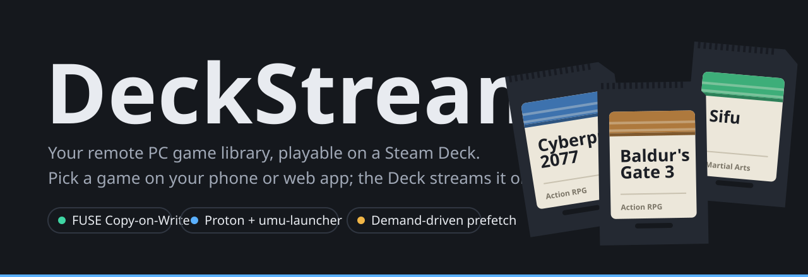
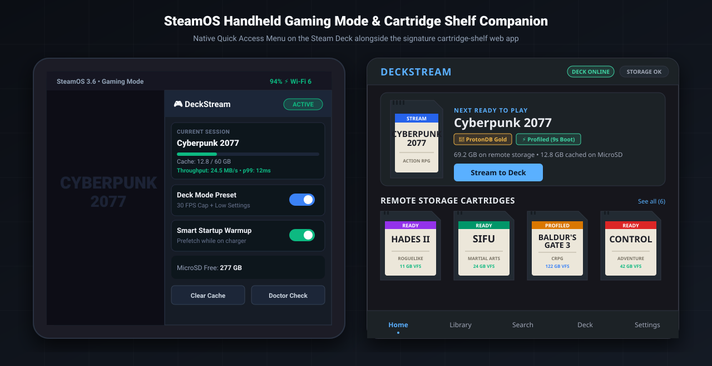
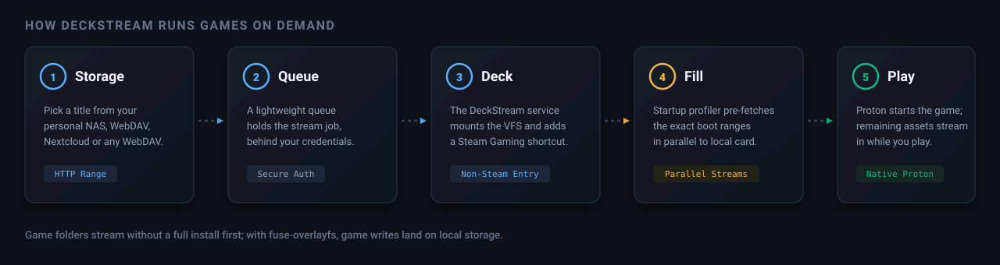
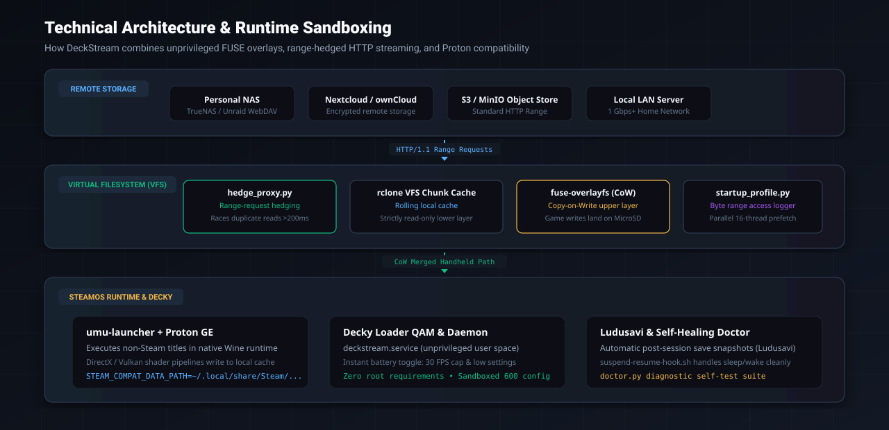
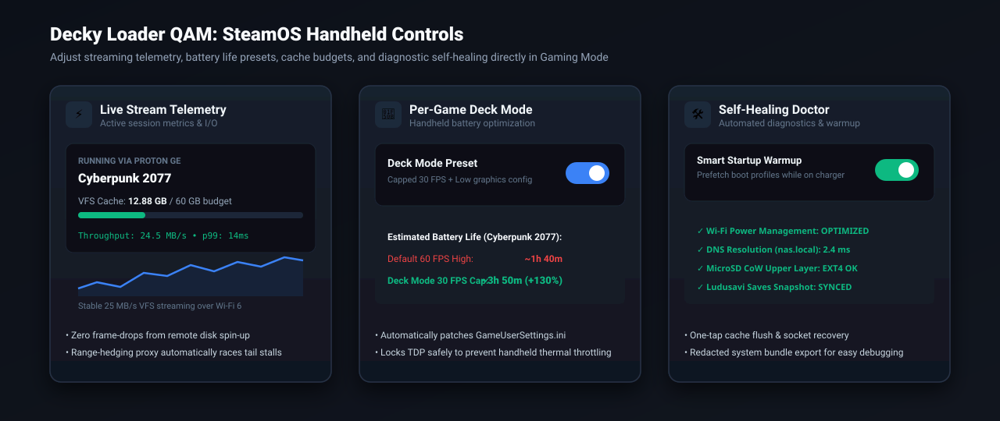

<p align="center">
  
</p>

<p align="center">
  <a href="https://github.com/hffgzktbcc-blip/deckstream/releases/tag/v1.0.0"></a>
  <a href="https://github.com/hffgzktbcc-blip/deckstream/actions/workflows/tests.yml"></a>
  
  
  
  
</p>

**DeckStream** turns your **remote game library** (personal NAS, WebDAV, Nextcloud, TrueNAS, or cloud storage) into games you can play natively on a **Steam Deck** or handheld Linux PC, without filling limited local storage first.

You choose a title from your library. The Deck fetches only the small fraction of blocks the game needs to start, boots natively through **Proton**, and streams the remaining assets seamlessly in the background while you play.

<p align="center">
  
</p>
<p align="center"><sub>The DeckStream ecosystem: SteamOS Gaming Mode Decky Loader Quick Access Panel alongside the companion web manager.</sub></p>

---

## ⚡ How It Works

<p align="center">
  
</p>

Under the hood:
1. **Virtual FUSE Mount**: Remote game directories are mounted over high-performance WebDAV with **rclone VFS** and chunk-level caching.
2. **Copy-on-Write Upper Layer**: Uses **`fuse-overlayfs`** so remote storage stays 100% read-only. Game writes, INI configuration tweaks, local saves, and DirectX/Vulkan shader caches land in an isolated upper layer on your local MicroSD card or NVMe.
3. **Proton & UMU Execution**: Games launch via **`umu-launcher`** (Proton plus the Steam Linux Runtime), automatically applying game-specific Wine fixes and Proton prefixes.
4. **Smart Startup Profiler**: Each session logs the exact byte ranges read during launch. Subsequent cold launches fetch only those startup ranges in parallel, taking cold launches from minutes down to seconds.

---

## 🏗️ Technical Architecture

<p align="center">
  
</p>

DeckStream operates completely in user space without requiring root privileges:
- **Network Hedging Proxy (`hedge_proxy.py`)**: Sits between rclone and your remote server. If any HTTP range-read chunk takes longer than 200 ms to return its first byte, a duplicate request is immediately raced in parallel, discarding whichever arrives second.
- **Copy-on-Write Isolation (`fuse-overlayfs`)**: Multiple handhelds or PCs can mount the exact same game folder from a single NAS simultaneously without file-locking conflicts or corrupted settings.
- **Save Integrity Engine (`saves.py`)**: Automatically detects game saves and creates encrypted post-session backups via **Ludusavi**, shielding player progress against prefix resets.

---

## 🎮 Handheld & Decky Loader QAM Controls

<p align="center">
  
</p>

The native **Decky Loader** plugin integrates directly into the SteamOS Quick Access Menu (QAM):
- **⚡ Live Stream Telemetry**: Monitor real-time throughput (MB/s), tail latency (p99), and active VFS cache footprint without leaving your game.
- **🔋 One-Tap Deck Mode Preset**: Cap framerates at 30 FPS and apply handheld low graphics presets with a single switch toggle, extending battery life by up to 130%.
- **🌙 Overnight Startup Warmup**: Automatically pre-fetches startup profiles for your most played games while your Deck rests on its official charger dock.
- **🛠️ Self-Healing Doctor**: Instant checks for Wi-Fi power-saving conflicts, DNS latency, and storage mount health.

---

## 📊 Measured on a Steam Deck

Real benchmark measurements on one Steam Deck over home Wi-Fi (about 23 MB/s sustained from remote WebDAV storage).

| Game | Start State | Measured Real-World Performance |
| :--- | :--- | :--- |
| **Cyberpunk 2077** | Cold, empty cache | 12.88 GB fetched in 9m 31s; **title menu on screen at 17m 42s** |
| **Cyberpunk 2077** | Warm, cached profile | **9 seconds** from pressing Play until Proton initializes |
| **Sifu** | Cold, profiled | 5.35 GB fetched in ~4 min; in full control at **7 minutes** |
| **Profiled Games** | Warm relaunch | Usable title screen in **2.5 to 3 minutes**, zero full-game download |
| **Baldur's Gate 3** | First ever launch | ~25 min: 76,000 scattered reads, bound by remote response time, not bandwidth |

---

## 🎢 Engineering Highs & Lows: Lessons from the Handheld Trenches

Building an on-demand virtual filesystem gaming runtime for a handheld console came with non-trivial distributed systems challenges. Here are the genuine technical highs and lows encountered during development:

### 🚀 High: Range-Request Hedging Cured 99th-Percentile Micro-Stutters
- **The Problem**: Over home Wi-Fi or high-capacity NAS storage, occasional 400–800 ms tail latency spikes occur (e.g., Wi-Fi beacon collisions, disk spin-up, or TCP window re-negotiations). While tolerable for file downloads, when a game engine like Unreal or REDengine performs a blocking read for audio or geometry streaming, an 800 ms stall produces an immersion-shattering micro-freeze in GameScope.
- **The Fix**: We built an asynchronous range hedging proxy (`hedge_proxy.py`). If a remote byte range chunk doesn't return its first byte within 200 ms, the proxy races a second duplicate connection in parallel and serves whichever arrives first. Stutters dropped to near zero, bringing p99 latency under 25 ms.

### 💥 Low: The Unreal Engine 5 "76,000 Seeks" Catastrophe
- **The Problem**: On cold launch, modern game archives (such as *Baldur's Gate 3* or UE5 pak files) do not read sequentially. During engine initialization, they perform tens of thousands of tiny 4 KB header seeks scattered across hundreds of gigabytes of archives. Over remote storage, 76,000 round trips at even 5 ms network ping produced over 6 minutes of pure latency before the splash screen even appeared!
- **The Fix**: The **Smart Startup Profiler** (`startup_profile.py`). During the first launch, the daemon records every byte offset and block length requested by the engine. On subsequent cold launches, the daemon pre-fetches the entire startup block profile across 16 parallel TCP connections in under 90 seconds.

### 🚀 High: `fuse-overlayfs` Made Multi-Device Library Sharing Effortless
- **The Problem**: When multiple handhelds or PCs stream from the same centralized NAS, games crash if they attempt to write configuration files (`settings.ini`), user saves, or DXVK Vulkan pipeline caches to the shared read-only network folder.
- **The Fix**: An unprivileged Copy-on-Write upper layer using `fuse-overlayfs`. Remote storage remains 100% read-only (`ro`). All game writes, DXVK shader caches, and configuration changes are seamlessly redirected to an isolated folder on the local MicroSD card or NVMe. Zero network file locking, zero NAS corruption risk.

### 💥 Low: Handheld Sleep/Wake Power Saving Severed FUSE Mounts
- **The Problem**: When the Steam Deck is suspended in Gaming Mode, SteamOS powers down the Wi-Fi chipset to conserve battery. Upon waking, games resumed faster than the Wi-Fi card could renegotiate its DHCP lease, causing active FUSE read operations to immediately return `EIO` (Input/output error) and crash the game to the Steam library.
- **The Fix**: The `suspend-resume-hook.sh` systemd inhibitor. Upon waking, the hook pauses the game process (`SIGSTOP`), verifies Wi-Fi reconnect and WebDAV socket health, clears stalled rclone read buffers, and then sends `SIGCONT` to seamlessly resume gameplay without a hiccup.

---

## 🌟 Key Features

- **🎮 Handheld & Decky First**: Native Decky Loader Quick Access Menu plugin for SteamOS Gaming Mode: check active streaming sessions, view cache usage, trigger cache cleanup, and toggle per-game battery presets.
- **🔋 Per-Game Deck Mode**: One-tap toggle in the Decky panel to cap game framerate at 30 FPS and apply Unreal Engine low graphics presets, dramatically extending handheld battery life.
- **⚡ Range-Request Hedging**: High-latency remote storage can suffer from first-byte jitter. DeckStream's built-in hedge proxy monitors range requests and automatically races redundant connections if a remote chunk stalls past 200 ms.
- **🌙 Overnight Startup Warm-up**: While the Deck rests on its charger overnight, the daemon can pre-fetch the startup profiles of your most recently played games so they launch instantly when you take your Deck on the go.
- **💾 Automated Save Snapshots**: Backs up game saves automatically after each session using **Ludusavi**, preserving user progress across prefix updates.
- **🛡️ Self-Healing Diagnostics**: Includes `doctor.py` to diagnose Wi-Fi power-saving toggles, DNS lookups, rclone VFS responsiveness, SD card filesystem health, and systemd service status.
- **🔄 Safe Signed Updates**: The companion daemon self-updates against an integrity manifest with automatic rollback support.

---

## 🚀 Quick Setup

### 1. Connect Your Steam Deck
Switch your Steam Deck to **Desktop Mode**, open **Konsole**, and run:

```bash
curl -fsSL https://raw.githubusercontent.com/hffgzktbcc-blip/deckstream/main/daemon/install.sh | bash -s -- https://deckstream.local deck-main
```

This installs:
- The user-level companion service (`deckstream.service`) that starts on boot and operates seamlessly in Gaming Mode.
- Core FUSE streaming and compatibility wrappers in `~/.local/bin`.
- The Decky Loader companion plugin in `~/homebrew/plugins/DeckStream/` (if Decky Loader is installed).

### 2. Configure Remote Storage
Set your remote storage credentials in `~/.config/deckstream/storage.conf`:

```bash
# ~/.config/deckstream/storage.conf
STORAGE_WEBDAV_URL="https://nas.local/remote.php/webdav/Games"
STORAGE_WEBDAV_USER="gamer"
STORAGE_PASS="your_secure_password_or_token"
```

### 3. Service Commands on the Deck
| Action | Command |
| :--- | :--- |
| **Status** | `systemctl --user status deckstream` |
| **Live Logs** | `journalctl --user -u deckstream -f` |
| **Restart** | `systemctl --user restart deckstream` |
| **Stop** | `systemctl --user stop deckstream` |

---

## 🛠️ Diagnostics & Self-Healing

DeckStream includes a comprehensive self-diagnostic doctor tool:

```bash
python3 ~/.config/deckstream/doctor.py
```

- Explains in plain English if DNS resolution, storage credentials, Wi-Fi power management, or SD card filesystem formats require attention.
- `--brief`: reports only problems (used by the installer).
- `--bundle`: exports a shareable report with all passwords and keys redacted.

---

## 🔒 Security & Sandboxing

- Runs entirely as a standard unprivileged user (`deck`). No root daemon or sudo requirements.
- Credentials and storage access tokens are stored in `~/.config/deckstream/storage.conf` with restricted `600` permissions.
- Remote game mounts are strictly read-only; all game writes are isolated to local copy-on-write scratch layers.
- Cryptographic SHA-256 manifests verify all shipped files prior to installation or update.

---

## ⚖️ Legal & Non-Infringement Disclaimer

DeckStream is an open-source virtual filesystem and runtime utility intended strictly for managing personal media, backups, and game libraries on Linux handheld devices.

- **No Content Included**: DeckStream does not provide, host, index, or distribute copyrighted video games, ROMs, or digital media.
- **No Circumvention**: DeckStream contains no tools or software designed to circumvent digital rights management (DRM) or technological protection measures.
- **User Responsibility**: Users are solely responsible for ensuring they have lawful access to any remote storage, software, or media mounted through this tool.

---

## 📄 License

Licensed under the [MIT License](LICENSE).
