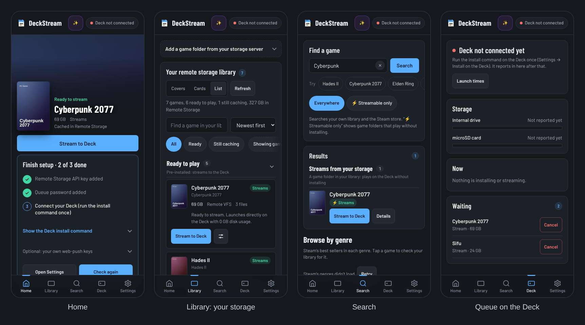

<p align="center">
  
</p>

<p align="center">
  <a href="https://github.com/hffgzktbcc-blip/deckstream/actions/workflows/tests.yml"></a>
  
  
  
</p>

**DeckStream** plays PC games you already own, stored on your own server (a NAS, Nextcloud, or anything that speaks
WebDAV), on a **Steam Deck** without copying the whole game to the Deck first.

You pick a game on your phone. The Deck mounts the game folder over WebDAV, fetches the parts the game reads at
start-up, starts it through **Proton**, and reads the rest while you play.

<p align="center">
  
</p>

---

## How it works

<p align="center">
  
</p>

| Part | What it is |
| :--- | :--- |
| **Storage server** | Yours. Serves the library over a small HTTP API ([docs/STORAGE_API.md](docs/STORAGE_API.md)) and the files over WebDAV. `scripts/storage_server.js` is a reference server for a folder of games. |
| **Site** | `index.html` (the phone app) and `api/*.js` on Vercel: library, search (your library plus Steam store titles), launch planner, and the Deck's job queue behind your password. |
| **Deck daemon** | `daemon/`: a user systemd service that polls the queue, mounts games with **rclone**, adds a Steam shortcut, launches with **umu-launcher** + Proton, and backs up saves with **Ludusavi**. |
| **Decky plugin** | `decky/`: the phone's status, queue, library and search in Gaming Mode's quick-access menu. |

On the Deck:
1. **rclone mount** of the game folder, read-only, with a local VFS cache.
2. **fuse-overlayfs** write layer when it is installed, so game writes land on local storage and the server copy stays untouched. Without it the game runs from the read-only mount.
3. **Start-up profile** (`startup_profile.py`): the first launch records the byte ranges the game reads; later cold launches fetch those ranges first, in parallel, before the game starts.
4. **After sleep**, the daemon runs `suspend-resume-hook.sh`: it waits for the network, probes the rclone mounts and lazily unmounts a hung one so it can be remounted.

Not on by default:
- **Hedge proxy** (`hedge_proxy.py`, `DECKSTREAM_HEDGE=1`): sends each range request twice and uses the first answer. It helped in a replay rig; it has **not been measured on a Deck**.
- **Self-update**: off until you set up a signing key (see `scripts/make_manifest.py`). Without it, re-run the install command to update.

## Measured

On one Steam Deck over home Wi-Fi (about 23 MB/s) from a cloud WebDAV store, October 2026, with the code this
project grew out of:

| Game | Start | Result |
| :--- | :--- | :--- |
| Cyberpunk 2077 | cold, empty cache | 12.88 GB fetched in 9 min 31 s; title menu at 17 min 42 s |
| Cyberpunk 2077 | warm | 9 s from Play until Proton starts |
| Sifu | cold, profiled | 5.35 GB in about 4 min; in control at about 7 min |
| Baldur's Gate 3 | first launch, no profile | about 25 min: 76,000 small reads, limited by server latency, not bandwidth |

The first launch of a game with no profile is slow when the server is far away. A NAS on your own network has far lower
latency; that setup has not been benchmarked yet.

---

## Setup

### 1. Storage server

```bash
STORAGE_KEY=change-me node scripts/storage_server.js --dir /srv/games --port 8780
rclone serve webdav /srv/games --addr :8781 --user deckstream --pass change-me
```

One folder per game inside `/srv/games`. Details and the API for your own server: [docs/STORAGE_API.md](docs/STORAGE_API.md).

### 2. Site (Vercel)

Import this repo into Vercel (no build step) and set:

| Variable | |
| :--- | :--- |
| `DECKSTREAM_SECRET` | the queue password the phone and the Deck use |
| `STORAGE_API_URL` | your storage server's API, e.g. `https://games.example.com/v1/api` (must be reachable from Vercel) |
| `UPSTASH_REDIS_REST_URL`, `UPSTASH_REDIS_REST_TOKEN` | the queue's storage. Required on Vercel: without it each function instance has its own memory and jobs get lost |
| `ALLOWED_DOWNLOAD_HOSTS` | optional extra https hosts for file links |
| `STEAMGRIDDB_API_KEY`, `VAPID_*` | optional: cover art, push notifications |

Open the site on your phone, and in **Settings** enter the storage key and the queue password.

### 3. Steam Deck

In Desktop Mode, open Konsole and paste the command from the app's Settings tab:

```bash
curl -sSL https://YOUR-SITE/daemon/install.sh | bash -s -- https://YOUR-SITE deck-main
```

It asks for the WebDAV address and the storage key, and installs the `deckstream` user service.

For the Gaming Mode panel, install [Decky Loader](https://decky.xyz), then in its settings use **Install plugin from URL**
with `https://YOUR-SITE/decky/DeckStream.zip`.

| Action | Command |
| :--- | :--- |
| Status | `systemctl --user status deckstream` |
| Logs | `journalctl --user -u deckstream -f` |
| Check the setup | `python3 ~/.config/deckstream/doctor.py` (`--bundle` writes a report with keys redacted) |

---

## Development

```bash
npm start                    # the app + real api/*.js + a mock storage library, at http://127.0.0.1:8765
npm test                     # the whole suite (Python, API, Decky panel, browser smoke test)
bash scripts/build_decky.sh  # rebuild decky/DeckStream.zip after changing decky/
python3 scripts/make_manifest.py   # after changing a shipped daemon file
```

The browser test needs Playwright (`npm i --no-save playwright && npx playwright install chromium`); it is skipped
without it, except in CI.

## Security

- The Deck side runs as the normal `deck` user. No root.
- Keys live in `~/.config/deckstream/storage.conf` (mode 600) and the browser's local storage.
- The site relays only the four storage endpoints, behind the queue password; file links are only fetched from your storage host.
- The installer checks every file against `daemon/manifest.json` (SHA-256).

## Legal

DeckStream manages games you own on storage you control.

- **No content**: it does not provide, host, index, search for or distribute games or other copyrighted material.
- **No circumvention**: it contains nothing that circumvents DRM or other technical protection measures.
- **Your responsibility**: you must have the right to the files on your storage server.

## License

[MIT](LICENSE).
